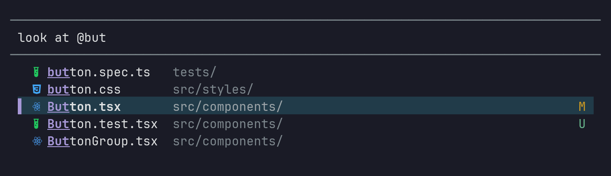
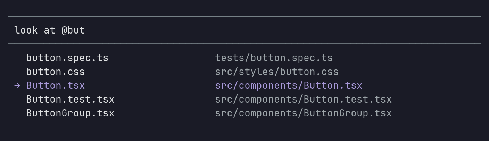
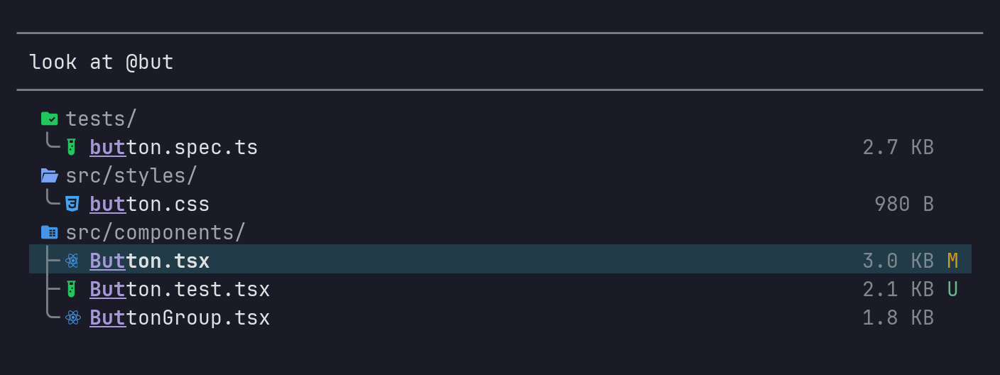
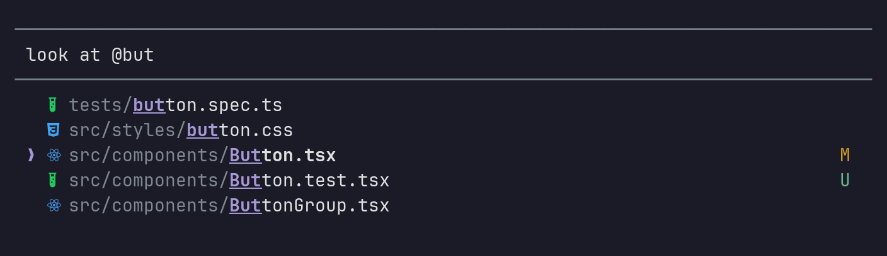
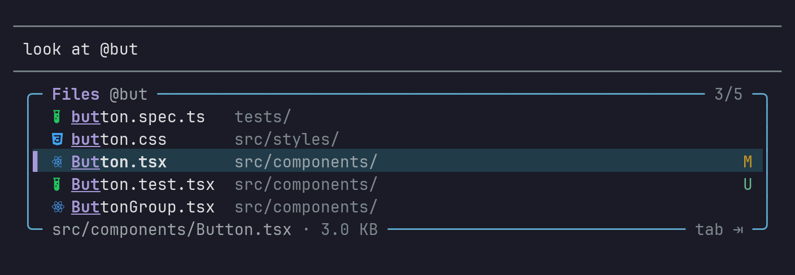
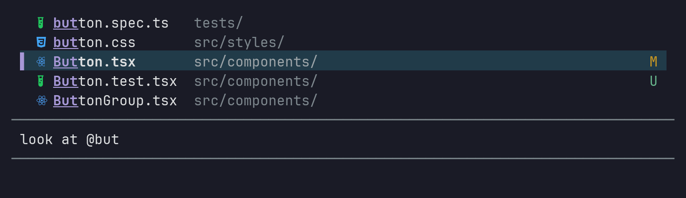
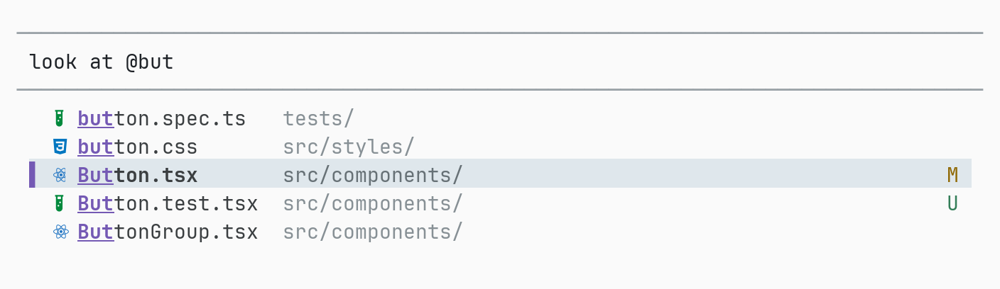

# pi-file-picker

A prettier `@` file picker for the [pi coding agent](https://pi.dev): Nerd Font icons per file type and
folder, brand colors, highlighted matches, parent folders, file sizes and git status, in four layouts.



<details>
<summary>Before: pi's stock list</summary>



</details>

pi still finds the files: its fd-backed search, `@"quoted paths"`, `~/` and Tab path completion all
work exactly as before. This extension only changes how the suggestions are drawn.

## Install

```bash
# try it for one session
pi -e /path/to/pi-file-picker

# install it for good (local checkout, or a git remote once you push one)
pi install /path/to/pi-file-picker
pi install git:github.com/<you>/pi-file-picker
```

The default icon set needs a [Nerd Font](https://www.nerdfonts.com) (v3) in your terminal. Without one,
switch to emoji or plain markers: `/file-picker icons emoji`.

## Use

Type `@` in the editor and keep typing, or press Tab on a path. ↑/↓ moves, Tab or Enter inserts,
Esc closes. Folders insert without a trailing space so you can keep drilling in.

### Layouts

| `columns` (default) | `tree` |
|---|---|
|  |  |
| **`compact`** | **`card`** |
|  |  |

- **columns**: icon and name, the parent folder in a dim column, git badge on the right. When every
  row lives in the same folder (Tab completion), the folder column shows sizes instead.
- **tree**: results grouped under their folders with tree guides, sizes and item counts.
- **compact**: one path per row, fzf-style, with the folder part dimmed.
- **card**: a rounded panel with the query, the position, and the selected entry's path and size.

### Placement

The list sits under the input box by default. `/file-picker placement above` draws it over the box
instead, still attached to it and in the same top-to-bottom order, in both fullscreen and regular
mode:



### Theme

Colors come from your pi theme (`accent`, `selectedBg`, `dim`, `warning`, …). Icon colors are
lightened on dark themes and deepened on light ones:



### Commands

| Command | Effect |
|---|---|
| `/file-picker` | Settings menu |
| `/file-picker preview` | Live preview of every layout with files from the current folder: ←/→ layout, `i` icon set, Enter applies |
| `/file-picker style <columns\|tree\|compact\|card>` | Pick a layout |
| `/file-picker icons <nerd\|emoji\|unicode\|none>` | Pick an icon set |
| `/file-picker placement <below\|above>` | List under or over the input box |
| `/file-picker git <on\|off>` | Git status badges |
| `/file-picker off` / `on` | Fall back to pi's stock list / restore |

Settings live in `~/.pi/agent/file-picker.json` (or under `$PI_CODING_AGENT_DIR`):

```json
{
	"enabled": true,
	"style": "columns",
	"icons": "nerd",
	"placement": "below",
	"gitStatus": true,
	"maxVisible": 8
}
```

`maxVisible` (3 to 20) is optional; without it the picker follows pi's `autocompleteMaxVisible`
setting (default 5).

### Git badges

`M` modified, `A` added, `U` untracked, `D` deleted, `R` renamed, `!` conflicted. Folders show a `●`
in the color of the most serious change inside them. Status comes from `git status --porcelain`,
cached for two seconds and refreshed after every agent tool call, so it never blocks typing.

## How it works

1. An autocomplete provider wraps pi's built-in one (`ctx.ui.addAutocompleteProvider`). It leaves the
   suggestions untouched and tags the ones that are files, checked against the file system so other
   providers' `@mentions` or `#issues` are left alone.
2. pi has no public hook for how suggestions are drawn, so the extension wraps
   `Editor#createAutocompleteList` on the shared `@earendil-works/pi-tui` prototype. Tagged suggestions
   get a `FilePickerList`; everything else (slash commands, other providers) keeps the stock
   `SelectList`. The stock list is still built first and lends its `onSelect`, so inserting a
   completion goes through pi's own code. The hook covers custom editors too (vim modes and the like),
   since they extend the same `Editor`. For `placement: "above"` it also wraps `render`, moving the
   list's lines (always the editor's last ones) above the box, and `handleMouse`, shifting rows to
   match.
3. If a future pi release renames that method, the extension shows a warning at session start and
   falls back to writing icons into the stock list's labels.

Tested with pi 1.3.0.

## Development

```bash
npm install
npm test          # unit tests plus real pi Editor integration tests (needs fd)
npm run check     # typecheck

# render the picker for any folder without starting pi
node scripts/render-picker.ts --cwd ~/code/app --type @comp --style tree --width 90

# after editing scripts/icon-spec.mjs
curl -sSLo /tmp/glyphnames.json https://raw.githubusercontent.com/ryanoasis/nerd-fonts/master/glyphnames.json
node scripts/generate-icons.mjs /tmp/glyphnames.json
```

Icons are declared by Nerd Font glyph name in `scripts/icon-spec.mjs`; the generator resolves every
name against the official glyph table and fails on typos, so the table cannot ship a missing glyph.

| Path | Role |
|---|---|
| `src/index.ts` | Extension entry: session wiring, `/file-picker` command |
| `src/runtime.ts` | Per-session state, independent of the extension API |
| `src/provider.ts` | Autocomplete wrapper that tags file suggestions |
| `src/editor-hook.ts` | Swaps the editor's list for file suggestions |
| `src/picker-list.ts` | The list component and its four layouts |
| `src/icons.ts`, `src/icon-table.ts` | Icon resolution and the generated glyph/color table |
| `src/git-status.ts` | Non-blocking `git status` cache |
| `src/preview.ts` | Interactive `/file-picker preview` |
